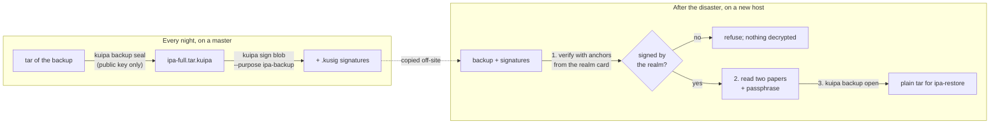

# Backups that survive losing everything

## The problem, in one story

You run a FreeIPA realm with three servers. Every night one of them makes
a backup. One day a fire, a ransomware attack or a bad upgrade takes out
all three servers, and the backup is the only thing between you and
re-enrolling every host in the company. That is the situation a backup
exists for, and it is exactly the situation in which today's FreeIPA
backups are weakest.

A FreeIPA backup is not an ordinary file. It holds the CA and KRA private
keys, the Directory Manager password hash, the Kerberos master key and,
since kuipa, the key directory `/var/lib/ipa/ku` with the realm's anchor
and escrow keys. Whoever reads it owns the realm. Whoever can *write* one
that `ipa-restore` accepts owns the realm too, because a restore loads
those secrets straight back into a server.

FreeIPA can encrypt backups with GnuPG, and it has two weaknesses when
every server is gone:

* **The key is on the server that died.** `ipa-backup --gpg` encrypts to
  the host's own GnuPG key (`--default-recipient-self`). Unless someone
  exported that key by hand, losing the server loses every backup it
  ever made.
* **Nothing says who made the backup.** GnuPG is only asked to encrypt,
  not to sign. Anyone who can drop a file into the backup repository can
  hand `ipa-restore` a backup of their own making.

This document describes how kuipa fixes both. A backup is **sealed to a
recovery key that lives on paper**, not on any server, and **signed by the
realm**, so a restore refuses anything the realm did not make. The
FreeIPA side (`ipa-backup --kuipa`, `ipa-restore`) is described in
`doc/designs/kuipa-backup.md` in the FreeIPA tree.

## The idea in two sentences

Sealing: backup hosts hold only the *public* half of a recovery key, so
they can lock a backup but not unlock it; the private half exists only as
a few printed pages that administrators keep in different places.
Signing: the realm's servers vouch, with a signature anyone holding the
realm's anchor thumbprint can check offline, that a master made this exact
file.



## What you keep, and where

| thing | where it lives | secret? |
|---|---|---|
| the **papers**: M printed pages, any N of which (with the passphrase) rebuild the recovery key | different drawers, safes, people | yes, together with the passphrase |
| the **recovery passphrase** | in the administrators' heads or a password manager, never printed with the papers | yes |
| the **recipient file** (`recipient.json`): the recovery *public* key | on every master, and inside every backup | no |
| the **realm card**: the realm name, the anchor thumbprints and the recovery key id | printed, kept with the papers | no, but it must be genuine |
| the **sealed backups** and their `.kusig` signatures | the backup repository, off-site copies | no, that is the point |

The papers are the same kind of paper backup kuipa already offers users
for lost devices (`DESIGN-recovery.md` §2.1): a secret hidden under a
passphrase, split with Shamir's scheme into N-of-M pages, printed as
words with error-correcting check words, so a smudged or misread word does
not lose the page. Backups reuse that machinery unchanged. What differs
is the page heading, which names the realm instead of a user.

## Using it

### Once: make the recovery key

On any machine that has the `kuipa` package. It needs no ticket and does
not contact a server:

```console
$ kuipa backup key create --realm EXAMPLE.TEST --threshold 2 --shares 3 \
        --out recipient.json
recovery passphrase: ****************
the same passphrase again: ****************
Backup recovery key K-4tgLx0oe… (set 3E5AA) written to recipient.json:
2 of 3 papers and the recovery passphrase open the realm's backups.

kuipa backup recovery shard 1 of 3 (any 2 are needed)  set 3E5AA
for realm EXAMPLE.TEST backups, recovery key id K-4tgLx0oe…
the passphrase you chose is also needed
01  bracelet curious edge legal alarm
02  python plot employer filter writing
…
```

Print the three pages and put them in three different places. Choose a
passphrase of at least 16 characters (five or six random words is the
usual advice); kuipa refuses shorter ones unless you say
`--weak-passphrase`, because anyone holding enough pages can try
passphrases offline.

Then **test the papers now**, not on the day of the fire:

```console
$ kuipa backup key check --recipient recipient.json < two-pages.txt
Those papers recover the key K-4tgLx0oe…: the passphrase and the key id match.
  paper 1: 0 unreadable word(s), 0 wrong word(s) repaired
  paper 3: 0 unreadable word(s), 0 wrong word(s) repaired
```

A word you cannot read is typed as `?`; the check words repair up to 24
unreadable or 12 wrong words per page.

Finally, on an enrolled host, print the **realm card** and keep it with
the papers:

```console
$ kuipa backup card --recipient recipient.json
kuipa backup card for realm EXAMPLE.TEST
  anchor dgt-VqrSdFC64H8R98ehg3kLJ8FzijPp84MmUJHHKMk
  recovery key K-4tgLx0oe… (set 3E5AA)
```

The card matters later: it is where the thumbprint comes from that lets a
brand-new host decide whether a backup is genuine.

### Every night: seal and sign

On the master, FreeIPA does this for you (`ipa-backup --kuipa`). By hand
it is two commands:

```console
$ tar -czf - /some/data | kuipa backup seal --recipient recipient.json \
        -o backup.tar.kuipa
$ kuipa sign blob --purpose ipa-backup backup.tar.kuipa header
```

`seal` needs only the public recipient file, so the master holds nothing
that can open its own backups. `sign` asks a realm server to state, under
the host's ticket, that this exact file was made by this host for the
purpose `ipa-backup`. It writes `backup.tar.kuipa.kusig` beside the file.

### After the disaster: open

On a new machine, with nothing from the old realm, bring the backup and
its `.kusig` files, two of the three papers and the realm card:

```console
$ kuipa backup open backup.tar.kuipa --also header \
        --realm EXAMPLE.TEST --anchor dgt-VqrSdFC64H8R98ehg3kLJ8FzijPp84MmUJHHKMk \
        --signer host/ipa1.example.test --out backup.tar < two-pages.txt
recovery passphrase: ****************
Opened backup.tar, after its signature verified.
```

The order of events matters and is deliberate:

1. **The signature is checked first**, against the anchors you gave. If
   the file was changed, signed for another purpose or by another signer,
   or signed by a realm you do not recognise, the command stops here. The
   papers are never asked for, and nothing has been decrypted.
2. Only then are the papers and passphrase read, and the recovery key
   rebuilt. If the key is not one the backup was sealed to, kuipa says
   "the passphrase or a paper is wrong", which is a different message from
   "the backup is damaged".
3. The backup is decrypted piece by piece. A damaged or reordered piece
   stops the command and no output file is left behind.

`--no-verify` skips step 1 for the rare case where the signatures are
lost. It says so in its output.

## How it works

### The container: why it is a stream

Backups are gigabytes, so `IPBK` (the container format) is a stream:
neither sealing nor opening ever holds the whole file in memory, and the
tar is piped straight into `seal` so no plaintext copy is written to disk.

```text
header_len(4 bytes) ‖ header ‖ chunk ‖ chunk ‖ … ‖ last chunk
header = "IPBK" ‖ version ‖ chunk size ‖ n ‖ n × recipient
recipient = set id ‖ key id ‖ ML-KEM ciphertext ‖ wrapped file key
```

* A random 32-byte **file key** is made for each backup.
* For each recipient, kuipa runs an ML-KEM encapsulation to that
  recipient's public key. The shared secret from that becomes a one-off
  key that locks (wraps) the file key. A container can name up to four
  recipients, which is how you rotate to a new recovery key without
  losing the old one: seal to both for a while.
* The data is cut into 64 KiB chunks, each encrypted with AES-256-GCM.
  Each chunk's nonce is a per-file prefix plus a counter, and its
  authenticated data is the whole header plus one bit saying "this is the
  last chunk". That one bit is what makes truncation, reordering and
  extension fail, and putting the header in every chunk means nobody can
  swap or remove a recipient without breaking everything.
* Which KEM was used is not a field: the ciphertext's length (1088 or
  1568 bytes) says it. Under a CNSA 2.0 crypto policy the recovery key is
  ML-KEM-1024.

The file says `IPBK` and nothing else about itself: no realm, no product.

The code uses what was already there. The chunk function
(`tang_pqc::primitives::seal_chunk`) is the same AES-256-GCM the rest of
kuipa uses, with a counter nonce and associated data. Wrapping the file
key reuses `primitives::seal`, as device-key deliveries (`IPDD`) do; a
single-use key is what makes its fixed nonce safe. No AES key-wrap
algorithm is involved.

### Signing: why the realm and not a key on the host

A recovery key made from papers cannot sign, because signing would need
the papers at every unattended nightly run. A signing key kept on the
master dies with the master. So backups use what kuipa already has: the
realm's **signing statement** (`DESIGN-sign.md`). The master asks a realm
server for a statement; the server checks its signing policy, writes the
statement into its transparency log, and signs it with its ML-DSA key,
which the realm's anchor vouches for.

The statement covers the digest of the *sealed* file (and of the plain
`header` file next to it). Because it covers the ciphertext, a verifier
needs no secret and can check it before touching anything inside.

Verification needs only the realm's anchor thumbprints and the realm name.
On an enrolled host those are the host's pinned anchors. On a fresh host
you give them on the command line (`--realm`, `--anchor`), taken from the
realm card. They cannot come from the backup itself: someone forging a
backup would forge the list too.

Files are digested as a stream, so verifying a 50 GB backup takes constant
memory.

### Anchor rotation and the card

Realm anchors can be rotated. A card printed before a rotation pins the
old anchor, but a statement signed after it carries the signed
"successions" that lead from the old anchor to the new one, and the
verifier follows up to four hops from a pinned anchor. So an old card still
verifies backups made after a rotation, as long as the servers still carry
that succession: 400 days by default. Reprint the card after rotating, and
certainly before it is that old.

## What an attacker gets

| the attacker has | result |
|---|---|
| the sealed backups | nothing: opening needs the recovery key, which exists only as papers plus a passphrase |
| the backups and a compromised master | nothing from past backups. The master can sign new backups, as any master could; they would still need sealing to your recipient to be useful |
| N papers but not the passphrase | nothing directly; they can try passphrases offline against the key id at PBKDF2 cost (2 million iterations by default), which is why the passphrase must be long |
| N papers and the passphrase | every backup sealed to that recovery key |
| the recipient file | the ability to *seal* files to your key, not to open any. Without a signature from the realm they are refused at restore |
| a forged backup and your realm card | a refusal at the signature check, before anything is decrypted |
| an old backup | it verifies: a signature says who made it and when, not that it is the latest. Restoring the newest one is the administrator's job |

## Why it is built this way

* **Papers, not a server share.** The only thing that survives losing
  every server is something that is not on a server. Kuipa's normal seals
  need a live kuipad and a Kerberos ticket, so they are useless exactly
  when you need them.
* **No registration in the directory.** User papers register their public
  key with the server so it can store per-device blobs for it. A backup
  recipient has no blobs, and a registration would be one more thing the
  directory must still hold at the moment it does not.
* **Reuse the realm's statement.** Nothing new to trust: the same
  anchors, policy and transparency log that already vouch for git commits
  and releases now also vouch for backups, and the log lets the realm list
  when each master made one. That log is for monitoring, not recovery: it
  is gone with the servers, and signatures verify without it.
* **A new container, not `IPDD`.** `IPDD` is one small key in one AEAD
  message. A backup is a stream, so it needs chunks and a last-chunk flag.
* **GnuPG stays in FreeIPA** as a separate choice; this design does not
  remove it.

## Status and tests

All of it is implemented.

* `tang-pqc::primitives`: the chunk AEAD, with a known-answer test checked
  against Python's `cryptography`.
* `kuipa-enroll::backup`: the container. Tests cover every chunk
  boundary, each of several recipients, a stranger's key, a flipped byte,
  swapped chunks, truncation and extension. (A whole-container test vector
  is not possible: ML-KEM encapsulation is random.)
* `kuipa-tools`: `kuipa backup key create|check`, `seal`, `open`, `card`,
  and `kuipa sign verify --realm --anchor`.
* The playground session (`contrib/ci/playground/session.sh`, "Backups
  sealed to paper") runs the whole story against a real KDC and servers:
  making papers, a wrong passphrase, sealing and signing, opening on a
  host with no enrollment, and the refusals: a planted file, a signature
  for another purpose, and an anchor the realm does not have.

Not yet run on real hosts: an actual `ipa-restore` from a sealed backup
after destroying a master (see the FreeIPA design).
