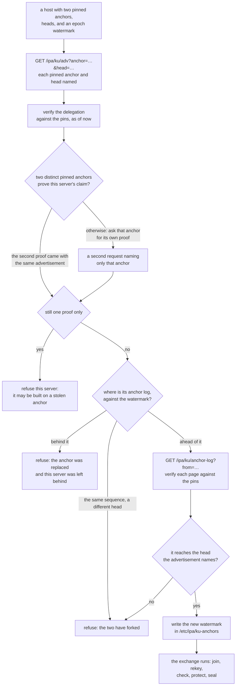
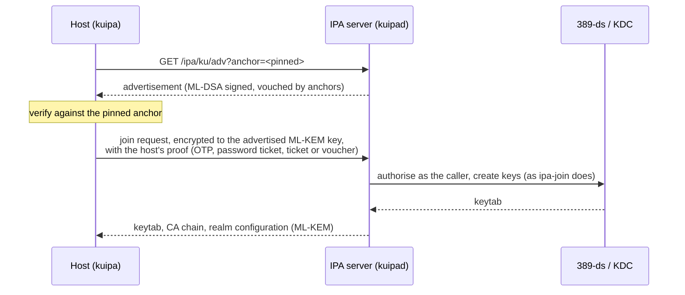
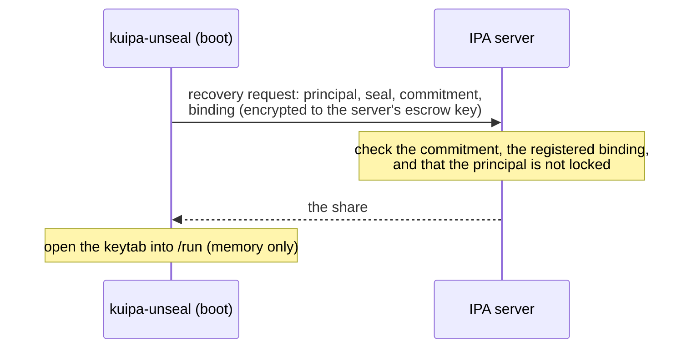

# Concepts

## Anchors: how a host knows it talks to its realm

Before a host trusts anything from a server, it must know the server
belongs to its realm. kuipa does not rely on DNS or on TLS for that: both
may use classical cryptography and might be attacked by a cryptographically
relevant quantum computer (CRQC), and a host joining for the first time
has no CA yet.

Instead, each IPA server holds an **anchor**: an ML-DSA key that stays on
the server. Anchors vouch for servers: every minute (by default) the servers run
an **anchor exchange**, authenticated with their own Kerberos keys, in
which each anchor signs a statement that lists the servers it trusts. A
server publishes its **advertisement** (`GET /ipa/ku/adv`): its keys, the
realm's configuration and CA, signed by the server and carrying the
anchors' vouches for it.

A host verifies an advertisement against an anchor it already **pins**:

* an **enrollment string** carries the thumbprint of the anchor of the
  server that issued it:

  ```text
  ipa-ku1:EXAMPLE.TEST:<anchor thumbprint>:<expiry>[:<OTP or secret>]
  ipa-ku2:EXAMPLE.TEST:<anchor thumbprint>:<expiry>:<size>:<root>[:<OTP or secret>]
  ```

  A version 2 string also pins the anchor's **vouch head** — a
  checkpoint of what its servers were vouched for — which lets the host
  check a server's proof with no signature at all;
* or the anchors are pinned ahead of time in `/etc/ipa/ku-anchors`, for
  images and configuration management.

An enrolled host keeps the realm's current anchors pinned and refreshes
them at every key rotation.

* **A host that pins two anchors** demands that two different anchors
  vouch for a server. A single stolen anchor then cannot impersonate the
  realm to it.
* **Anchors rotate.** An old anchor signs a hand-over to its successor,
  so pinned hosts follow.
* **A host also keeps a watermark** of the realm's anchor history, and
  refuses a server that is behind it.

### What every request is checked against

The same checks run before a join, a rekey, a health check or an
unsealing:



Two proofs count only for the *same* claim: the same server, the same
signing key, the same delegation expiry. A rotated anchor and its
successor count once, not twice; an anchor frozen to a pinned head
counts head-wise only ([Frozen pins](realm/enrollment.md#frozen-pins)).
A first contact with no watermark records one from a proved quorum, so
from then on a server left behind fails.

## Enrollment: nothing on the wire a CRQC could open



The host proves it may join in one of these ways:

| proof | who uses it |
|---|---|
| a one-time password from `ipa host-add --random` | the classic way, now also a temporary Kerberos key of the host |
| a user's password | `ipa-client-install -p admin` habits; the password never leaves the host |
| an existing Kerberos ticket | administrators with a ticket, external IdP or passkey users |
| a voucher | autoscalers and image pipelines: single use, bound to one hostname |
| a staged bundle | hosts with no network at first boot: the keys arrive in a signed, sealed file |

When the proof is Kerberos-based, the server's answer is also bound to the
realm's Kerberos keys. Then even a server built on a stolen anchor cannot
answer.

## Keys rotate

`kuipa rotate-keys` (run monthly by `kuipa-rotate.timer`) gets the host new
keys over the same protected exchange, authenticated by its current keys.
A recording of the exchange plus the old keys does not reveal the new
ones.

## Sealed keytabs and files

A sealed keytab or file is encrypted so that opening it needs one of the
realm's servers. Each server's share is bound to a key only that server
holds, and is released only for bindings registered on the principal's
entry in IPA.



* `kuipa protect` seals the host keytab; `--keytab` a service's keytab;
  `--file` any file. The file on disk becomes a link to an unsealed copy in
  memory, refilled at every boot.
* Removing the host (or locking it), or sealing again, makes old copies
  stop opening.

## Seals: users' own sealed files

A **seal** is a set of rules a user keeps on the IPA servers: which
**factors** opening a file needs (a registered **device** key, the user's
**ticket**), until when, how many times, whether **sessions** are allowed.
A sealed file holds two shares:

* a **server share**, released only under the seal's rules;
* a **device share**, which only one of the user's registered devices can
  open.

Neither opens the file alone, so an IPA administrator holding the servers'
keys still cannot read users' files. See
[Sealing your own files](user/sealing.md).

## Tang

`kuipad` can also act as a post-quantum **Tang** server, and `tang-pqc` is
its Clevis pin: LUKS volumes bound to it unlock automatically wherever the
servers are reachable. Unlike sealed keytabs, Tang is stateless by design:
anyone with the volume and network access to a Tang server can unlock it.
