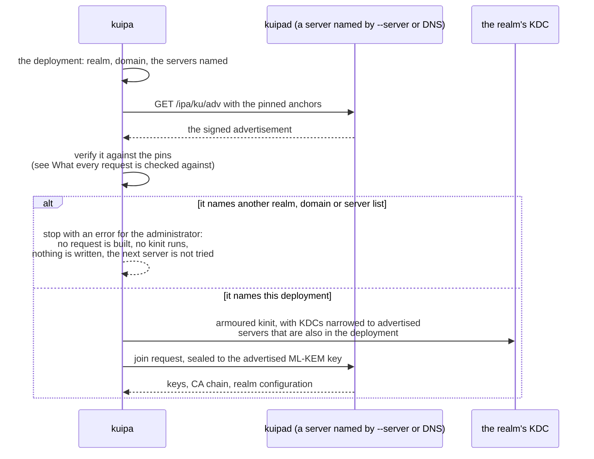

# Enrolling a host

`kuipa enroll` joins a host to the realm: it finds and verifies the
realm's servers, proves the host may join, and installs what it receives.

## What the host must know first

Before it sends anything, `kuipa` verifies a server's advertisement
against an anchor it trusts. It gets that anchor from one of:

* an **enrollment string**, from `--enrollment-file F`,
  `$KUIPA_ENROLLMENT_FILE`, or standard input:

  ```text
  ipa-ku1:EXAMPLE.TEST:<anchor>:<expiry>[:<OTP>]
  ipa-ku2:EXAMPLE.TEST:<anchor>:<expiry>:<size>:<root>[:<OTP>]
  ```

  An expired string is refused before anything is sent. A version 2
  string also pins the anchor's vouch head, so the realm's proof is
  checked against it with no signature;
* or **pinned anchors** in `/etc/ipa/ku-anchors`, with `--realm R`, for
  images and configuration management.

It finds servers from `--server` (repeat it for each), else DNS SRV
records for `--domain` (default: the host's domain). Every advertisement
must describe exactly that deployment: if a verified server names another
realm, domain or server list, `kuipa` stops instead of trying the next
one.



A mismatch is not a failed verification: the advertisement verified
against the pins. It says the realm's own description of itself does not
match what you asked for — a misconfigured server, or someone pointing your
hosts at another deployment. Fix the server or the `--server`/DNS list;
`kuipa` will not pick a different server for you (see
[Troubleshooting](troubleshooting.md#the-advertisement-does-not-verify)).

## The ways to join

**With a one-time password** from `ipa host-add --random`, appended to the
enrollment string:

```sh
kuipa enroll --server ipa1.example.test --enrollment-file string.txt
```

The OTP doubles as the host's temporary Kerberos key, so the join is
authenticated with Kerberos and the host gets its real keys straight away.
On realms where `host-add` does not set that key yet, add `--ldap-otp` to
have the server check the OTP with an LDAP bind instead.

**With a user's password** (anyone allowed to join hosts):

```sh
kuipa enroll --server ipa1.example.test --enrollment-file string.txt \
    --principal admin --password-file pw.txt
```

`kuipa` gets a ticket with the password through an armoured exchange with
the realm's KDC; the password never leaves the host. Without
`--password-file` it reads the password from standard input, or asks for
it on a terminal. A realm that wants more than the password — the value of
an OTP token, a PIN, a RADIUS or IdP answer, the PIN of a passkey — is
asked for on the terminal too, inside the same armour, so an impostor's KDC
cannot collect it; run this on a terminal, or use the ticket path below.
With `--realm` instead of an enrollment string, the pinned anchors
authenticate the realm.

**With an existing ticket**, for administrators already logged in, or
users of an external IdP or passkeys:

```sh
kuipa realm-info --server ipa1.example.test --enrollment-file string.txt \
    --krb5-dir /tmp/realm                         # verified Kerberos configuration
KRB5_CONFIG=/tmp/realm/krb5.conf kinit -n -c /tmp/armor.ccache @EXAMPLE.TEST
KRB5_CONFIG=/tmp/realm/krb5.conf kinit -T /tmp/armor.ccache admin
kuipa enroll --server ipa1.example.test --enrollment-file string.txt --use-ccache
```

`realm-info` writes a Kerberos configuration whose KDCs and PKINIT anchors
come from the verified advertisement, so even the `kinit` is armoured with
anchors the host can trust.

**With a voucher**, for autoscalers and image pipelines:

```sh
kuipa voucher-key --out /run/kuipa-ephemeral.jwk      # optional: bind the voucher
kuipa enroll --realm EXAMPLE.TEST --voucher-file web17.voucher \
    --ephemeral-key /run/kuipa-ephemeral.jwk
```

See [Cloud virtual machines](../scenarios/cloud.md#join-instances-from-an-autoscaler-with-vouchers)
for the whole voucher workflow.

**From a staged bundle**, with no network:

```sh
kuipa prepare                                    # mode A: make a key, report it
kuipa enroll --bundle web5.bundle --enrollment-file string.txt
```

The host opens the bundle offline and installs it. At first contact,
`ipa-client-complete.service` runs `kuipa complete`, which replaces the
staged keys with fresh ones and lists the steps `ipa-client-install`
still has to run.

## What it installs

| file | holds |
|---|---|
| `/etc/krb5.keytab` | the host's keys |
| `/etc/ipa/ca.crt` | the IPA CA chain |
| `/etc/ipa/ku-anchors` | the realm's current anchors, refreshed at every key rotation |
| `/var/lib/ipa-client/ku/krb5.conf`, `pkinit-anchors.pem` | Kerberos configuration from the enrollment, used when the system has none for the realm |
| `/var/lib/ipa-client/ku/state.json` | realm, host name, servers, protection (root only) |
| `/var/lib/ipa-client/ku/realm.json` | realm, host name and servers, for users' `kuipa seal` |

`kuipa enroll` does what `ipa-join` does. The rest of
`ipa-client-install` (SSSD, certificates, DNS update and so on) is not its
job; integrating it into the installer is part of the pending FreeIPA
work.

## Secrets never come from the command line

Enrollment strings and passwords are read from files or standard input,
never from arguments, where other users could see them. From a pipe, the
string is the first line and the password the second:

```sh
printf '%s\n%s\n' "$STRING" "$PASSWORD" | kuipa enroll --server ipa1.example.test --principal admin
```
