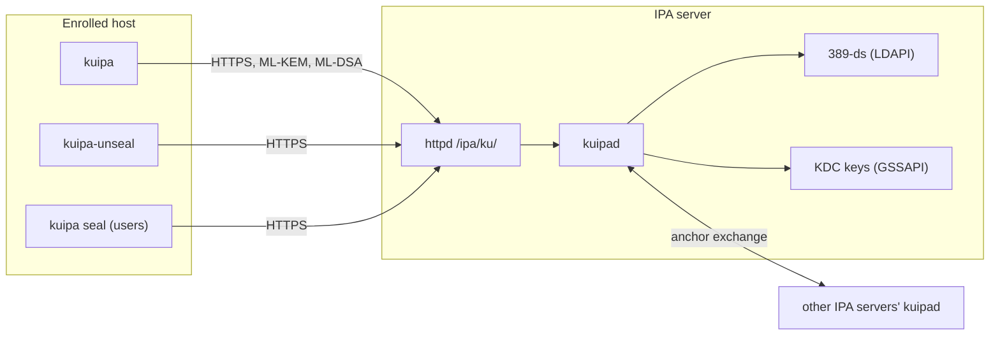

# Introduction

A FreeIPA client's identity is its keytab: the long-term Kerberos keys of
`host/<fqdn>@REALM`. Whoever holds a copy of it *is* that host to the realm.
kuipa protects that keytab, and other secrets like it, with post-quantum
cryptography wherever they travel or rest:

* **Enrollment.** A new host checks that it talks to the real realm,
  proves it may join, and receives its keytab, the IPA CA chain and the
  realm's configuration encrypted with ML-KEM. Recorded traffic stays
  useless to a future quantum computer.
* **Key rotation.** Host keys rotate on a timer, with forward secrecy.
* **At rest.** A keytab, or any file, can be sealed on disk so that a copy
  (a backup, a disk image, a snapshot) opens only with the help of the
  realm's servers, and stops opening when the host is removed.
* **Your own files.** Users seal files to a vault of their own, under a
  policy they choose: a copy opens only with their device, their login,
  and a server that agrees.
* **Signing under your login.** Users and CI sign files and git commits
  by their Kerberos ticket, with no signing key to guard.
* **A record anyone can check.** Every server logs what it does with
  users' and hosts' secrets in a public, append-only log, which users
  watch for their own entries and independent witnesses cosign.
* **Offline enrollment, vouchers, trusted realms and Tang.** Hosts can be
  staged in advance and enroll without network access, join from an
  autoscaler with single-use vouchers, accept users of trusted realms, and
  unlock encrypted disks against the realm's servers.

[What kuipa is for](use-cases.md) lists every use case, for whom, and
how far along each one is.

kuipa changes how secrets travel and are stored, not how they are made:
Kerberos, the KDC and FreeIPA's key creation stay as they are. All
cryptography is FIPS 203 ML-KEM, FIPS 204 ML-DSA, HKDF, AES-256-GCM and
SHA-2 from OpenSSL, within the system's crypto policy.

> **Status: research prototype.** The protocol and its formats still
> change, and parts of the FreeIPA integration (the LDAP schema, access
> controls, `ipa` commands and installer options) do not exist yet. Do not
> use kuipa to protect a production realm. Each chapter says what works
> today and what is planned.

## The pieces

| program | runs on | does |
|---|---|---|
| `kuipad` | IPA servers, behind httpd | answers enrollments, rekeys, unseal requests and vault operations; keeps the server's keys; vouches for the other servers |
| `kuipa` | enrolled hosts and their users | enrolls the host, rotates its keys, protects keytabs and files, checks health; `kuipa seal` for users' own files |
| `kuipa-unseal` | enrolled hosts | opens sealed keytabs and files at boot, or for gssproxy, without a human |
| `kuipa-voucher` | wherever vouchers are issued | issues and requests single-use enrollment vouchers |
| `tang-pqc` | any Clevis client | a post-quantum Tang client and Clevis pin, for disk encryption |

## How this book is organised

* [Concepts](concepts.md) explains anchors, advertisements, enrollment,
  sealing and vaults, the ideas the rest of the book uses.
* [What kuipa protects](security.md) says, in plain words, which attacks
  it stops and which it does not. Read it before deciding where to use it.
* [Quick start](quickstart.md) tries everything in a throwaway playground
  and builds the programs.
* **Realm administrators** deploy `kuipad` and decide how hosts may join.
* **Host administrators** enroll hosts, rotate their keys and protect
  their keytabs and files.
* **Users** seal their own files.
* **Scenarios** walk through whole deployments, such as cloud machines.
* **Reference** lists every command, file and setting, and includes the
  full design.
