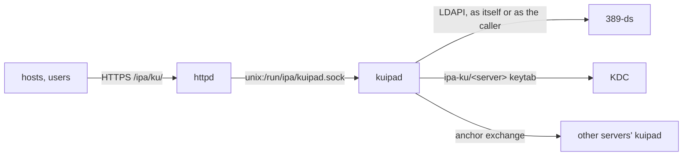

# Deploying kuipad on an IPA server

Every IPA server that hosts should be able to enroll through runs `kuipad`,
socket-activated behind the server's httpd. This chapter sets one server
up; repeat it on each, and they find each other.

> **Not yet automated.** FreeIPA's installer does not set kuipa up, and
> the LDAP schema and access controls kuipa needs are not published yet
> (see [TODO.md](https://github.com/abbra/kuipa/blob/main/TODO.md)). The
> steps below are what that integration will do. Use them on a test realm
> only.

## What the server needs



1. **A Kerberos identity.** The daemon is the service `ipa-ku/<server>`.
   Clients and other servers get tickets for it; it uses the same key to
   reach its peers.
2. **The right to act for callers.** When a host or an administrator
   authenticates with Kerberos, the daemon talks to LDAP *as them*
   (protocol transition and constrained delegation to `ldap/<server>`), so
   FreeIPA's existing access controls decide what they may do.
3. **A key directory**, `/var/lib/ipa/ku`, with the server's anchor and
   keys.
4. **The LDAP schema and access controls** for kuipa's attributes (escrow
   bindings, staging, vouchers, trusts, vaults). Not published yet.

## 1. The service principal and its keytab

On any enrolled machine with an administrator's ticket:

```sh
ipa service-add ipa-ku/ipa1.example.test
ipa service-mod ipa-ku/ipa1.example.test --ok-to-auth-as-delegate=true

# Let it act for callers towards this server's LDAP.
ipa servicedelegationtarget-add kuipa-ldap
ipa servicedelegationtarget-add-member kuipa-ldap \
    --principals=ldap/ipa1.example.test@EXAMPLE.TEST
ipa servicedelegationrule-add kuipa
ipa servicedelegationrule-add-member kuipa \
    --principals=ipa-ku/ipa1.example.test@EXAMPLE.TEST
ipa servicedelegationrule-add-target kuipa --servicedelegationtargets=kuipa-ldap
```

For further servers, add their `ldap/` and `ipa-ku/` principals to the same
target and rule.

On the server itself:

```sh
install -d -m 0700 /var/lib/ipa/ku
ipa-getkeytab -s ipa1.example.test -p ipa-ku/ipa1.example.test \
    -k /var/lib/ipa/ku/kuipa.keytab
```

## 2. The configuration

`/etc/ipa/kuipad.json` (start from `contrib/kuipad.json.example`):

```json
{
  "realm": "EXAMPLE.TEST",
  "domain": "example.test",
  "basedn": "dc=example,dc=test",
  "server": "ipa1.example.test",
  "ldap_uri": "ldapi://%2Frun%2Fslapd-EXAMPLE-TEST.socket",
  "principal": "ipa-ku/ipa1.example.test@EXAMPLE.TEST",
  "service": "ipa-ku@ipa1.example.test",
  "keytab": "/var/lib/ipa/ku/kuipa.keytab",
  "ca_file": "/etc/ipa/ca.crt",
  "pkinit_anchors_file": "/var/lib/ipa-client/pki/kdc-ca-bundle.pem",
  "key_dir": "/var/lib/ipa/ku"
}
```

The other settings have sensible defaults; [Configuration](../reference/configuration.md)
lists them all: the anchor exchange (`peers`, `discover_peers`,
`peer_interval`, `anchor`), rate limits, configured trusts, enctypes.

## 3. The keys

```sh
kuipad generate-keys
```

This creates the server's **anchor**, its signing key, and its join,
escrow and trust keys in `/var/lib/ipa/ku`, and prints the anchor's
thumbprint. Keep it: enrollment strings and image pins name it.

In a large realm, not every server needs an anchor: set `"anchor": false`
on most of them and keep a few anchor servers (see
[Keys and rotation](keys.md)).

## 4. httpd and the units

```sh
install -m 0755 target/release/kuipad /usr/libexec/kuipad
install -m 0644 contrib/kuipa.conf /etc/httpd/conf.d/kuipa.conf
install -m 0644 contrib/kuipad.socket contrib/kuipad.service /etc/systemd/system/
systemctl daemon-reload
systemctl enable --now kuipad.socket
systemctl reload httpd
```

httpd forwards `/ipa/ku/` to the daemon's socket and adds the
`X-Forwarded-For` header the per-address rate limit uses. The daemon
starts on the first request, with its own sandbox: its keys are read-only,
core dumps are off.

## 5. Check it

```sh
curl -s https://ipa1.example.test/ipa/ku/adv | head -c 300; echo
kuipad anchor
journalctl -u kuipad -f
```

The advertisement is a JSON Web Signature with the server's keys and the
realm's configuration. The log shows each request's outcome. Refusals
are logged with their reason, while clients only see an empty `403`.

Within a minute, the log also shows the **anchor exchange**: the server
finds the other IPA servers in LDAP (`cn=masters`), exchanges anchors with
those running kuipad, and starts vouching for them. A server that does
not run kuipa yet answers `404` and is retried every round.

## Restarting after key changes

The daemon reads its keys at start. Restart it (`systemctl restart
kuipad`) after `rotate-keys`, `rotate-anchor`, `prune-keys`,
`add-voucher-key` and the Tang commands. The socket stays open, so clients
see no outage.
