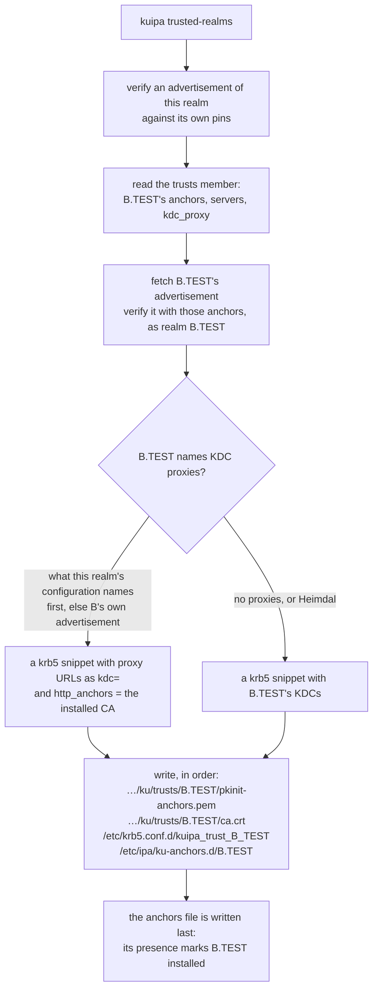

# Trusted realms

Two IPA realms that trust each other let each other's users log in. kuipa
makes the hosts of realm A able to accept users of realm B safely: A's
servers vouch for B's anchors, and A's hosts install B's KDCs and PKINIT
chain only after verifying them through A.

## Establishing a trust

B invites, A answers:

```sh
# On a server of B: an invitation, valid 7 days by default.
kuipad trust-invitation --days 2
#   ipa-ku-trust1:B.TEST:<B anchor>:<one-time secret>

# On a server of A, with the invitation in a file:
kuipad establish-trust --invitation-file invite.txt --server ipa1.b.test
```

Hand the invitation over through a channel you trust, as you would an
enrollment string. `establish-trust` verifies B's advertisement against the
invitation's anchor, proves to B that it is a server of A, and both sides
derive a shared trust secret that neither chose alone. Each realm then
records the other, and the cross-realm `krbtgt` keys are created from that
secret, as `ipa trust-add --trust_secret` would.

From then on, each realm's servers advertise the other's anchors, and
refresh the partner's servers and anchors every ten exchange rounds.

A trust can also be configured by hand in `kuipad.json`:

```json
"trusts": [
  { "realm": "B.TEST", "domain": "b.test",
    "servers": ["ipa1.b.test"], "anchors": ["<B anchor thumbprint>"] }
]
```

## On the hosts

```sh
kuipa trusted-realms
```

installs every realm the host's own realm trusts, verified through it, and
removes those it no longer trusts. Run it after enrollment and
periodically (for example from `kuipa-rotate.timer`). Until it has run,
the host has no configuration that would accept B's users. Details are in
[Day-to-day host care](../host/care.md#trusted-realms).

## Reaching a KDC through an HTTPS proxy

Some realms expose only HTTPS: their KDCs are not reachable from other
realms' hosts. Such a realm names its KDC proxies (MS-KKDCP, FreeIPA's
`/KdcProxy`) in its own `kuipad.json`:

```json
"kdc_proxy": { "urls": ["https://ipa1.example.test/KdcProxy"], "ca": "system" }
```

`ca` says what authenticates the proxies' TLS certificates: `realm` (the
default, and then absent) for that realm's IPA CA, `system` for the
host's trust store — for a front end with a public certificate. A trust
recorded by hand can name proxies of its own (`kdc_proxy` in a `trusts`
entry), which is how you point your hosts at a proxy that realm B does
not advertise. A trust established with `establish-trust` takes B's own
`kdc_proxy` from B's verified advertisement.

`kuipa trusted-realms` then writes the Kerberos snippet for B with those
URLs as its `kdc`s:



The generated snippet keeps Kerberos authenticating the KDC the same way
it does without a proxy — `pkinit_anchors` and `pkinit_pool` still name
B's chain — and adds `http_anchors = FILE:…/ku/trusts/B.TEST/ca.crt`
only when the proxies are authenticated by B's CA. MIT Kerberos only:
Heimdal does not speak MS-KKDCP, and a realm installed there keeps
B's direct KDCs. The proxy adds no trust: it hides the exchange from the
network, and B's anchors and PKINIT chain are still what authenticates
it.

To a host, reaching a proxy also means the HTTP requests themselves can
go through the environment's proxy: `kuipa` and `kuipad` honour
`HTTPS_PROXY`, `HTTP_PROXY`, `ALL_PROXY` and `NO_PROXY`. List your own
realm's servers in `NO_PROXY` when only other realms are behind it.

## Limits

* Trusts with Active Directory are not covered: AD runs no kuipa.
* kuipa authenticates the PKINIT chains and protects the trust secret in
  transit. Cross-realm Kerberos and PKINIT themselves stay what Kerberos
  makes them.
* A front end in `ipa trust-add` for invitations is part of the pending
  FreeIPA integration.
