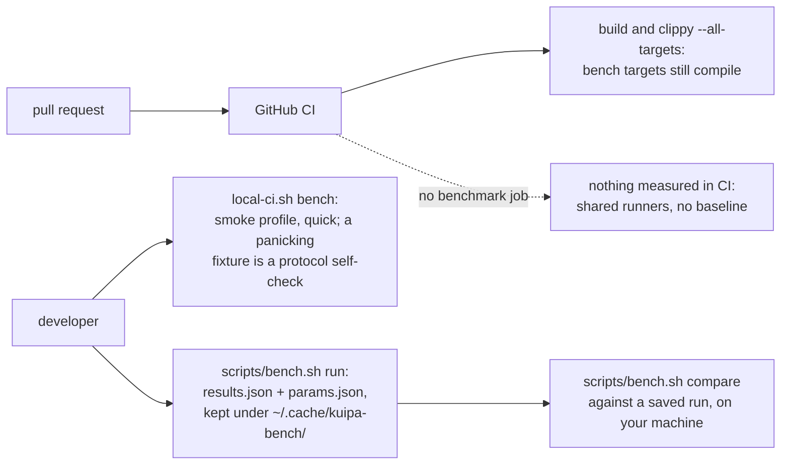

# Benchmarks

The measured cost of enrollment, escrow, vouchers and the cryptography under
them, and how to run them so that two runs can be compared.

## Where the benchmarks live

Criterion targets sit in the crate whose code they measure, so a bench breaks
with the code it benches:

| Target | Crate | Measures |
| --- | --- | --- |
| `crypto` | `kuipa-enroll` | ML-DSA sign/verify/keygen per parameter set, ML-KEM encapsulate/decapsulate, Merkle roots and paths, AEAD seal/open, hashing, voucher sign/verify, keytab MIT encode/decode, delegation JSON, policy construction |
| `protocol` | `kuipa-enroll` | Advertisement build/cache/wire, realm verification (CA count scaling), OTP and Kerberos join round trips, request/response wire codec, rekey |
| `anchors` | `kuipa-enroll` | Voucher issuance, verification and Merkle proofs versus leaf count, anchor-state insert and wire, `Trust::compute` versus servers and claims, delegation verification |
| `escrow` | `kuipa-enroll` | Sealing across N servers, unsealing with N recovery round trips, escrow wire codec |
| `blind` | `ml-dsa-blind` | Blinded request, blind signing, finalization, verification, round trip, wire encode, context construction, per parameter set |
| `certs` | `kuipa-perf` | CA keygen, self-signing, chain construction — RSA-2048, EC P-256 and ML-DSA-65 |

`kuipa-perf` is the fixture crate: it synthesizes realms, keytabs,
certificates and anchors, and is a *dev-dependency* of the crates above rather
than a bench owner itself (it is not published). Synthetic data — keytab keys,
claims, filler leaves — comes from a fixed-seed generator; every private key,
CA keys included, comes from OpenSSL, so no fixture key can be re-derived from
the source. Its fixtures verify as they are built —
a realm that fails to verify panics during setup, so a broken fixture can never
produce a number.

## Profiles

`KUIPA_BENCH_PROFILE` selects the fixture sizes. `production` is the default.

| Profile | Servers | CA certs | Keytab entries | Escrow servers | Vouched claims | CA |
| --- | --- | --- | --- | --- | --- | --- |
| `smoke` | 2 | 1 | 1 | 2 | 3 | EC P-256 |
| `production` | 4 | 1 | 4 | 4 | 8 | EC P-256 |
| `pqproduction` | 4 | 1 | 4 | 4 | 8 | ML-DSA-65 |
| `large` | 8 | 4 | 6 | 8 | 64 | EC P-256 |

`pqproduction` is `production` with a post-quantum certificate authority: the
fixture realm's PKINIT chain is a real ML-DSA-65 self-signed CA certificate,
built through `synta-certificate`, so advertisement verification and CA parsing
are measured against the certificate sizes and signature algorithms a
post-quantum deployment actually ships.

Scaling benches sweep their own axis (leaf counts, server counts, payload
sizes) around the profile's base sizes: `smoke` sweeps shallow, `large` goes
deep, so one bench file serves both. Two axes stop short of the sweep:
escrow fan-out caps at 32 servers because every slot is a whole realm (keygen,
trust exchange, advertisement) whose quadratic setup would dominate a deeper
sweep, and CA count caps at 8 because `tang-pqc` refuses to parse an
advertisement over 256 KiB — a post-quantum chain of 16 CAs is 342 KiB, so a
deeper sweep would measure a refusal rather than a verification.

## Running

```sh
scripts/bench.sh run --profile production
scripts/bench.sh run --profile pqproduction --quick
scripts/bench.sh run --targets crypto,blind --samples 50
cargo bench -p kuipa-enroll --bench anchors          # one target, default profile
KUIPA_BENCH_PROFILE=large cargo bench -p kuipa-enroll --bench protocol
```

`--quick` is criterion's `--sample-size 10 --measurement-time 1`: fast enough
for CI, coarse enough that you should not read much into a single number.

Each run collects criterion's estimates into `results.json` and stores it with
`params.json` — git commit and dirty flag, profile, fixture sizes, criterion
flags, platform — under `~/.cache/kuipa-bench/<timestamp>/`:

```sh
scripts/bench.sh list
scripts/bench.sh compare ~/.cache/kuipa-bench/20261001T120000Z ~/.cache/kuipa-bench/20261024T090000Z
```

Comparison reads the stored files, so a baseline survives `cargo clean`.
`--baseline NAME` additionally saves a criterion baseline for per-benchmark
`--baseline NAME` comparisons inside `target/criterion`.

## Peer repair scheduler

The ignored `kuipad` test runs real repair schedulers and receiver admission on
loopback, backed by per-node persistent state. Choose the anchor topology with
`KUIPA_ANCHORS`: a count (for example, 6), `all`, or 0 (the default, the
historical synthetic-key workload). Each count must not exceed any requested
replica count.

For a small smoke run covering both topologies:

```sh
KUIPA_REPLICAS=8 KUIPA_ANCHORS=6 KUIPA_ROUNDS=20 cargo test --release -p kuipad measure_scheduler_repair -- --ignored --nocapture
KUIPA_REPLICAS=8 KUIPA_ANCHORS=all KUIPA_ROUNDS=20 cargo test --release -p kuipad measure_scheduler_repair -- --ignored --nocapture
```

For the full sizing matrix, run each topology separately:

```sh
KUIPA_REPLICAS=60,100,200,300 KUIPA_ANCHORS=6 KUIPA_ROUNDS=20 KUIPA_PHASE_TIMEOUT_SECS=1800 cargo test --release -p kuipad measure_scheduler_repair -- --ignored --nocapture
KUIPA_REPLICAS=60,100,200,300 KUIPA_ANCHORS=all KUIPA_ROUNDS=20 KUIPA_PHASE_TIMEOUT_SECS=1800 cargo test --release -p kuipad measure_scheduler_repair -- --ignored --nocapture
```

The anchor fixture creates a signing key and claim per replica, a separate
anchor key for each anchor, and one signed vouch per anchor covering every
claim. It admits these entries and persists the same initial state on each
node. The update renews node 0's claim and its own anchor's signed vouch;
other anchors' vouches are unchanged. Repair transfers go through the actual
peer admission, merge, persistence and scheduler paths. Convergence compares
live snapshots normalized with the production retention rules at the fixture
time, ignoring generation metadata; a snapshot byte-identical to node 0's
counts as converged without normalization. A final full-sweep mismatch fails
the test. Maintenance, subsequent re-vouching by other anchors, claim expiry and
epoch evolution are not simulated.

The default replica sizes are 10, 20, 40, 60, 100, 200 and 300. The test
drives explicit routine rounds until convergence or `KUIPA_ROUNDS` (default
20), followed by an independent full sweep. JSON lines report topology,
initial persistence, attempts, completions, failures, retries, chunk counts,
body and plaintext HTTP stream bytes, elapsed time, state size and convergence.
`KUIPA_PHASE_TIMEOUT_SECS` bounds each round; `KUIPA_BUSY_PER_NODE` injects
authenticated busy responses. `kinds` counts messages and body bytes per
request and response kind (probe, bucket hashes, pushed and returned
entries, whole-snapshot chunks…), the way to see where repair bytes go.

The separate `KUIPA_ANCHORS=0` workload uses non-anchor claims and adds one
public key in its update. `KUIPA_EXTRA_KEYS` adds synthetic keys only to that
workload to exercise chunking; it is rejected with anchors and must not be
interpreted as an anchor count. Manual ticks disable automatic scheduling only
inside the test.

This single-host loopback experiment uses synthetic channel-bound identity,
durable local stores, no TLS or Kerberos, empty epochs and no maintenance
loop. HTTP stream bytes include HTTP framing but not TLS or TCP/IP overhead.
Random keys and concurrent execution make timing and sizes nondeterministic;
it does not establish WAN behavior or production convergence latency. The
all-anchor case signs and verifies many large vouches and may require substantial
time, memory and disk space; increase the per-round timeout as needed. On one
24-thread development host, the 300-replica all-anchor case took about two
and a quarter minutes and 13 GB of resident memory for all in-process
replicas.

## CI

`local-ci.sh bench` (opt-in, like `msrv`) runs the smoke profile in quick mode
and fails if any benchmark panics — which is the fixture crate's verification
assertion firing, so the job doubles as a protocol self-check — or if the run
collected no results at all. It keeps no baseline and compares nothing, so it
does not catch timing regressions: use `scripts/bench.sh compare` against a
saved run, on a machine you control, for that.

The GitHub workflow does not run benchmarks: its runners are shared and
unknown, and a run nothing is compared with measures nothing.  Its clippy
job builds every bench target (`--all-targets`), so they keep compiling.



## Reading the numbers

- Keygen and certificate building are *fixture setup*: they run outside timed
  loops, except in `certs`, which measures them on purpose.
- Throughput annotations are criterion's: `Bytes` for payload-shaped work
  (MB/s), `Elements` for count-shaped work.
- `join/otp`, `join/gss` and `rekey/gss` measure kuipa's side of the round
  trip against an in-memory directory. The directory's Kerberos check is a
  byte comparison of a fake token, not `gss_accept_sec_context` and a keytab
  lookup, so the Kerberos round trips are lower bounds on a real enrollment.
  LDAP and a real KDC are not in the loop — see the local CI docs for those.
- `realm/verify` checks the advertisement's signatures and metadata. The CA
  certificates it carries are decoded, not parsed as X.509: kuipa hands them
  to kinit and TLS as they are. `cert/parse` measures the X.509 parse.
- `escrow/unseal` models every server but the last being unreachable: one
  recovery request per slot on the client, one server-side recovery.
- `trust/compute` gives each attested peer its own anchor and proof, so it
  pays one ML-DSA verification per attested delegation.
