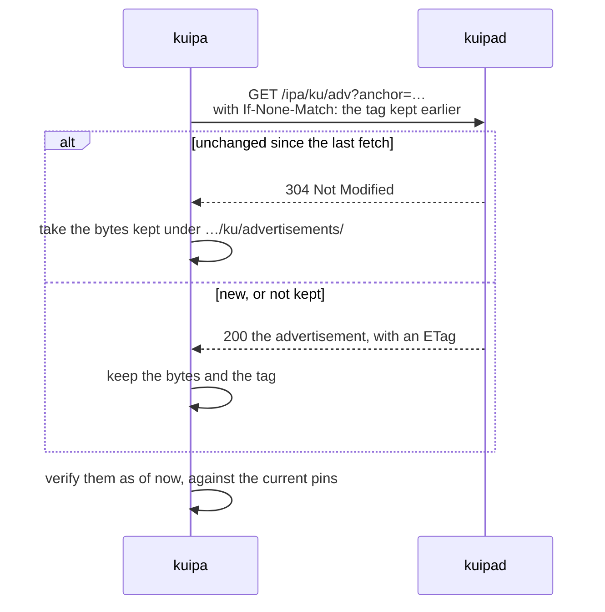
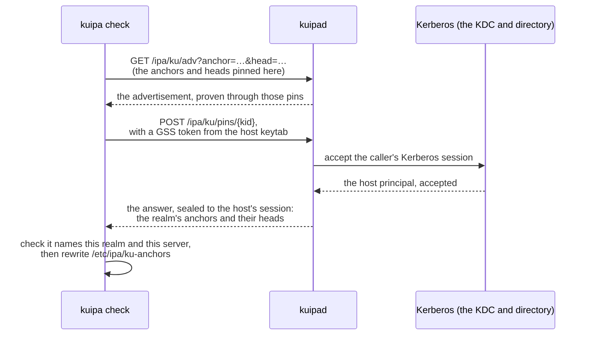

# Sizing: storage and traffic

How much a realm's servers store, and how much travels between hosts and
servers, and between the servers themselves, for each kind of action.
Use it to size disks and links, and to see where the bytes go.

Figures are for the default crypto policy: ML-DSA-65 signatures,
ML-KEM-768, SHA-256. Under a CNSA 2.0 policy (ML-DSA-87, ML-KEM-1024,
SHA-384) multiply keys, signatures and the messages they dominate by
about 1.3: the advertisement grows from 28.2 KB to 36.0 KB.

Each figure is marked as one of:
- **measured**: from the playground session or a measurement test (see
  [How these were measured](#how-these-were-measured));
- **computed**: from the encodings and intervals in the code, for sizes
  no run exercises at scale.

## The one number to remember: the advertisement

Almost every exchange a client makes starts by fetching a server's
advertisement (`GET /ipa/ku/adv`), and verifying it against the anchors it
pins. The advertisement holds the server's keys, the realm's
configuration and CA chain, and the delegation that proves the server
belongs to the realm.
| realm | advertisement | |
|---|---|---|
| 1 server | 24.8 KB | measured |
| 2 servers | 25.1 KB | measured |
| 8 servers | 26.4 KB | measured |
| 32 servers | 30.9 KB | measured |
| the playground (2 servers, a trusted realm, a 1.5 KB CA) | 28.5 KB | measured |

It grows by about 190 bytes per server, plus the CA chain and PKINIT
anchors as they are (a classical CA certificate is about 1.5 KB, an
ML-DSA one about 5.5 KB).

Three things keep it from being paid on every exchange:
- **One fetch proves the quorum.** A host that pins two or more anchors
  needs two distinct anchors' proofs of a server (DESIGN §4.4); the
  advertisement carries both (§4.3), so one fetch is enough.
- **Pinned heads instead of signatures.** A head proof is a few hundred
  bytes where a signature proof is about 7.5 KB (DESIGN §4.9). Hosts pin
  heads at enrollment and refresh them at every `kuipa check` and key
  rotation (§4.5), so most proofs are heads: a typical advertisement is
  about **19 KB**, up to 38 KB with two signature proofs.
- **Conditional fetches.** `kuipa` keeps each advertisement and asks again
  with `If-None-Match`; an unchanged one costs a `304 Not Modified`, a few
  hundred bytes of headers, and is verified again like fresh bytes (§4.3).
  An advertisement changes when it is re-signed or the anchor exchange
  publishes, every few days.

So the advertisement costs about 19 KB at a host's first contact with a
server, and almost nothing afterwards.

A `kuipa check` ends with one more small request, the **pins refresh**,
so the heads the host pins stay fresh between monthly rekeys (DESIGN
§4.5) — this is what keeps proofs head-shaped rather than 7.5 KB
signatures:

## Client actions

Downloaded and uploaded bytes per action, for a host that pins two
anchors in a realm of two servers, with the advertisements already kept
from earlier actions, as in steady use. **Measured**, from the playground
report.

### Hosts

| action | requests | up | down |
|---|---|---|---|
| enroll: OTP, password, ticket or voucher (first contact) | 2 adv, join or rekey, 2 claim-log pages | 3.2–7.1 KB | 70 KB |
| enroll offline: the bundle, out of band | — | — | 17.9 KB bundle |
| rotate keys (monthly timer) | adv, rekey | 3.3 KB | 21 KB |
| health check (`kuipa check`), with its pins refresh | adv per server, pins | 3.3 KB | 20 KB |
| seal the keytab or a file (`kuipa protect`) | 3 adv (304), rekey or register, unseal check | 5.8 KB | 1.2–2.4 KB |
| **unseal at boot** (`kuipa-unseal`), per sealed keytab or file | recovery request only: the sealed file keeps the server's key | 2.3 KB | 57 bytes |
| install trusted realms | 2 adv | — | 26 KB |
| fetch replica secrets (`kuipa keys fetch`), per secret | adv (304), keys | 3.3 KB | 1.2 KB |
| post-quantum Tang: provision / recover | `adv` 10.3 KB, then `rec` | 2.2 KB | 57 bytes |

### Users

| action | requests | up | down |
|---|---|---|---|
| a seal operation (create, policy, add device, share, approve, list…) | adv, seal | 3.2–14 KB | about 26 KB: the reply carries the signed seal descriptor, about 23 KB |
| seal a file (offline once the seal is described) | 2 adv (304), for the servers' escrow keys | — | 0 |
| **open a sealed file** | recovery request only | 3.2 KB | 1.2 KB |
| open within a session | recovery request with the session token | 23 KB | 1.2 KB |
| start a session, or an offline one | adv, seal | 3.3 KB | 49 KB |
| watch the seal (`kuipa tlog watch`), per server | adv (304), lookup | 3.3 KB | 5–6 KB |
| sign files or a commit (`kuipa sign`) | adv (304), sign | 3.3 KB | 22 KB (the signature bundle) |

Before these changes, the same session downloaded 11.5 MB in 389
advertisement fetches; it now downloads 2.6 MB in 208, most of them
`304`s. What remains is mostly the actions' own answers: seal
descriptors, signature bundles, enrollments.

### Per host and per user, per day

Key rotation runs monthly from `kuipa-rotate.timer`, about 24 KB. A host
that also runs `kuipa check` and `kuipa trusted-realms` daily, as the docs
suggest, adds about **50 KB a day** for a realm of two servers, plus
2.3 KB per sealed keytab or file at each boot. A user who opens 20 sealed
files and runs an hourly watch against two servers adds about
24 × 12 KB + 20 × 4.4 KB ≈ **0.4 MB a day**.

## Between servers

### The anchor exchange

Servers repair their claims and vouches with each other (DESIGN §4.2.1)
over `POST /ipa/ku/peer/sync`, authenticated with their Kerberos keys.

- **Who talks to whom.** A server selects up to four rotating directly
  connected IPA topology neighbors or configured peers every `peer_interval`
  (60 s by default) or local change; an independent timer selects all of
  those peers every ten intervals.
- **A quiet repair is a probe.** Two servers in the same state compare
  digests. With a real KDC and cached peer context, a probe request is about
  1.1 KB, mostly the Kerberos token, and its answer about 70 bytes (measured,
  playground). The delegation and epoch log tail also travel on first contact,
  when changed, or when the receiver has forgotten them, such as after a restart.
- **Selective repair moves changed entries.** Servers compare bucket hashes,
  about one per eight entries, to find a renewal's claim and vouch. Large
  states or selections instead trigger whole-state transfer (DESIGN §4.2.1).
- **What changes.** A server's claim renews at two thirds of its 90-day
  validity, every 60 days, and every anchor then vouches again. Each
  anchor also vouches again at half of a vouch's 7-day validity, every
  3.5 days. A vouch has a 3.3 KB signature plus its claim log; the log
  also retains earlier claims and tombstones, so it grows with history.

| realm | exchange state per server | |
|---|---|---|
| 2 servers, both anchors | 12.7 KB | measured (playground) |
| 10 servers, all anchors | 65 KB | measured (DESIGN §4.2) |
| 60 servers, 6 anchors | 55 KB | measured (DESIGN §4.2) |
| 60 servers, all anchors | 489 KB | measured (DESIGN §4.2) |
| 300 servers, 6 anchors | 136 KB | measured (loopback benchmark) |
| 300 servers, all anchors | 5.2 MB | measured (loopback benchmark) |

One claim renewal and its anchor's new vouch, until every server has them:
a single-host loopback run with full-mesh configured peers, 20 routine rounds
available, no injected busy responses, and synthetic channel-bound identity. The table sums
request and response bodies in the routine rounds through convergence;
it excludes the subsequent full sweep, Kerberos, TLS and HTTP headers.
It also excludes maintenance and subsequent re-vouching by other anchors;
it is not the total renewal cost. All final idle and update sweeps
converged, with no failed repair attempts in this run.

| replicas | anchors | routine rounds | realm-wide bodies | per replica |
|---|---|---|---|---|
| 60 | 6 | 3 | 1.09 MB | 18.1 KB |
| 100 | 6 | 4 | 2.18 MB | 21.8 KB |
| 200 | 6 | 5 | 5.20 MB | 26.0 KB |
| 300 | 6 | 6 | 9.59 MB | 32.0 KB |
| 60 | all | 3 | 1.13 MB | 18.8 KB |
| 100 | all | 3 | 1.89 MB | 18.9 KB |
| 200 | all | 5 | 5.35 MB | 26.8 KB |
| 300 | all | 6 | 9.59 MB | 32.0 KB |

For comparison, in the full-mesh workload with at least five servers, the
routine timer selects four peers per minute, and the sweep selects every
other server every ten minutes. At 1.1 KB a probe this is approximately
6.3 MB a day sent per server for routine probes, plus 9.4 MB (60 servers) or
47 MB (300 servers) for sweeps. A sparse IPA topology selects only direct
neighbors, so its sweep traffic and propagation time differ.
Overlapping pending repairs are deduplicated, so actual traffic
can be lower; retries and local changes add traffic. Each server also receives
roughly as many requests (computed).
The final 300-replica update sweep in this loopback run took 1.71 s
with six anchors and 9.49 s with all anchors; this is not a WAN or
production convergence measurement.

The measured initial update has similar traffic with six or all anchors.
Subsequent re-vouching by other anchors adds changes to propagate, so total
renewal traffic still depends on the number of anchors. Anchors also make
the state larger, and each re-vouch costs a signature. Large realms should
still give the anchor role to a few servers (DESIGN §4.2).
Advertisements select up to two anchors for signature proofs when available;
matching pinned head proofs take precedence, and every matching head proof is
served, so a client pinning several heads can receive more than two proofs.

### Witnesses and auditors

A witness fetches each server's signed head every pass (once a minute by
default) and posts its cosignature when the head changed. A head is
about 3.4 KB plus 2.5 KB per cosignature it carries (computed). Heads
change once per `tlog_head_interval` (an hour), so a witness costs each
server about **5 MB a day**, nearly all of it fetching an unchanged
head. `kuipa-audit tlog` reads the whole log: 100 bytes per leaf.

### LDAP replication

What `kuipad` writes to the directory (below) replicates to every IPA
server through 389-ds, as any IPA data does: each write crosses each
replication agreement once.

## Server storage

### Files under the key directory

| file | size | |
|---|---|---|
| keys: signing, anchor, join, escrow, trust, Tang (each ML-DSA-65 key 2.7 KB, ML-KEM-768 key 1.7 KB as JWK) | about 15 KB, plus retired keys until pruned | measured |
| `delegation.json` | 15 KB | measured |
| `epoch.json`, the anchor epoch log | 7.3 KB, growing with each anchor rotation | measured |
| `peers.state`, the exchange state | see the table above: 12.7 KB to 5.2 MB | measured |
| `tlog/<log>/leaves`, the public log | **100 bytes per event**, kept for ever | measured |
| `tlog/<log>/openings/YYYY-MM` | **about 150 bytes per event**, kept 13 months (`tlog_retention_months`) | measured |

An event is a seal change, a key release, a signature or a Keys fetch,
and it is logged only on the server that handled it. A realm of 1,000
users who each open 5 sealed files a day logs 5,000 events a day: 0.5 MB
of leaves and 0.75 MB of openings a day across the realm, so about
180 MB of leaves a year and at most 300 MB of openings at any time.

### In LDAP, on every server

Estimated from what each attribute holds (base64 where LDAP stores
text), and, for sealed data, from the sealed files the playground wrote.
The playground keeps its directory in memory, so the entries themselves
are not measured.

| what | size |
|---|---|
| a sealed keytab or file's binding, per server | 43 bytes, on the principal's entry |
| a seal: policy, state, owner, sharing | about 0.5–1 KB |
| a device in a seal | about 1.8 KB, nearly all its ML-KEM public key |
| a deposit (`seal deposit put`, `escrow luks`) | the sealed file: about 6.3 KB for a small secret |
| a device key escrowed under a recovery code, or with the helpdesk | about 8 KB |
| a release request and its approvals | under 1 KB |
| a spent voucher | 43 bytes on the host entry |
| a staged host's keys (offline enrollment) | a few KB, until first contact |

A realm with 1,000 users, each with 2 seals of 2 devices, adds about
1,000 × 2 × (0.75 + 2 × 1.8) KB ≈ **9 MB**; 10,000 hosts with a sealed
keytab and one sealed file, against 4 servers, add 10,000 × 2 × 4 × 43
bytes ≈ **3.4 MB**.

## On hosts

| file | size |
|---|---|
| `servers.json`, the cached advertisements | about 28 KB per server |
| a seal's stored descriptor (`seals/<name>.seal`) | 21 KB, plus 1.7 KB per device |
| a device key | 1.8 KB |
| a sealed file | the plaintext plus about 6.3 KB for two servers (2.4 KB in session mode) |
| a signature bundle (`.kusig`) | 21 KB |
| an offline bundle | 17.9 KB: too big for a 16 KB cloud user-data limit |

## How these were measured

- **Client traffic**: `python3 contrib/ci/playground/sizes.py` reads a
  playground report (`./contrib/ci/local-ci.sh playground-test`) and
  prints request and response sizes per route; `--steps` adds each
  step's totals.
- **Advertisement against realm size**: `cargo test -p kuipa-perf --test
  sizes -- --ignored --nocapture`.
- **Exchange state and deltas**: `cargo test --release -p kuipa-enroll
  measure_exchange_sizes -- --ignored --nocapture` (DESIGN §4.2).
- **Server and host files**: `KUIPA_KEEP_PLAYGROUND=1
  ./contrib/ci/local-ci.sh playground-test` keeps the playground's
  directory; its `keys-<server>/` and `users/` directories hold what a
  server and a user store.
- **Tang**: `crates/tang-pqc/examples/escrow.rs` (tang-pqc DESIGN §3.4).
